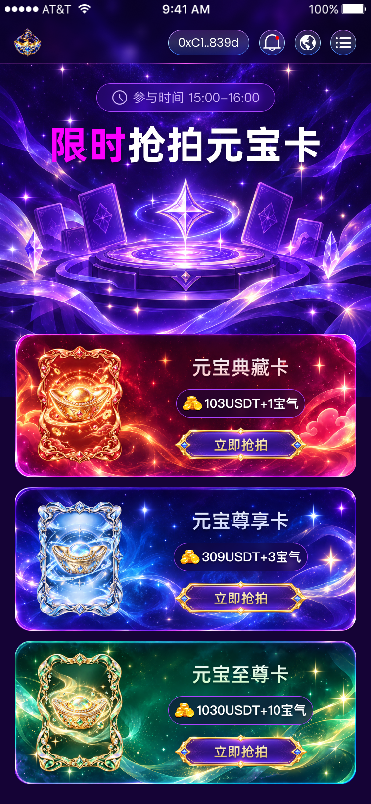

# 抢拍卡牌实现清单

## 范围

- 目标：按 Figma `NVwAAv12WZx1LiCTqPMNWD` / `30129:5073` 还原抢拍卡牌静态页面；尺寸、颜色、间距、字号、行高与字距采用读取值，不目测。
- 允许修改：新增 `src/pages/main/auction/` 与 `src/assets/auction/`；注册 `/auction`；接入侧栏抢拍入口与首页进入抢拍按钮；相关文档、导航契约测试与必要颜色变量。
- 为避免重复素材，首页与抢拍共同使用的三张卡图、抢拍按钮、时钟图片移入 `src/assets/common/`，只更新原首页对应 import，不修改首页视觉和卡牌状态逻辑。
- 不做：抢拍API、支付/授权/合约、登录流程、库存或成功抢拍模拟、新依赖、其他业务页面、Header结构重建、远程Git、正式Logo门禁调整。
- 事实依据：Figma MCP图层数据及同节点REST原始属性、整画板导出图、开发者下载资源、项目路由/布局文档、`PROJECT_TERMS.md`。当前无已确认术语替换；保持设计的“宝气”，不自行改成首页“元气”。

## 设计原稿

画板750×1624。顶部28px设备状态栏不属于H5；浏览器对照为750×1596，源坐标y减28。公共Header高100px，仍使用既有品牌、通知、语言、钱包摘要、菜单及分隔线动效，不伪造连接地址。Header原有30px水平padding与Figma品牌x27的差异单独保留，不以业务页重构公共外壳。

## 精确量测（Figma源单位）

所有坐标均相对画板，输入现有750px px-to-vw流程，不手动缩放。小数行高来自REST `style.lineHeightPx`，不是按文字框高度推断；字间距全部为0。

| 区域 | 实测 |
| --- | --- |
| 全局背景 | `#150336` |
| 页面背景图 | x0/y0，750×801；原始PNG保留完整星空、卡牌平台与丝带，不用CSS绘制替代 |
| 参与时间框 | x195/y168，361×58，padding10/30、gap10，圆角999，描边1 `#AB44FF`，背景`#6815FF`20%；MCP对应CSS背景模糊10px（REST效果radius20） |
| 时间图标 | 32×32，复用首页时钟 |
| 时间文字 | `参与时间 15:00-16:00`；PingFang SC Regular400，26px，行高36.39999771118164px，颜色`#D1B7FB`；文本框257×36 |
| 页面主标题 | x99/y236，552×110；Alibaba PuHuiTi Bold700，80px，行高109.75999450683594px；“限时”`#FB00FF`，其余白色；阴影0/4/10黑色30% |
| 列表 | x30/y674，690×910；三项高290，gap20；页面底部余40 |
| 背景框 | 各690×290、圆角30；红/蓝/绿完整PNG，包含装饰边框，避免重复CSS描边 |
| 卡图 | 各182×240；卡内x40，红卡y24、蓝/绿y25；复用首页卡图，按源图层及导出比例核对实际裁切 |
| 右侧内容组 | 卡内x303/y40，307×220；用Grid与正常流表达，不以absolute放置文字与按钮 |
| 卡名 | 307×55文字框；Alibaba PuHuiTi Medium500，40px，行高54.87999725341797px，居中；阴影0/4/4黑色25% |
| 卡名渐变 | 180°，0% `#EFF3FB`；100%：红`#FDC4C5`、蓝`#C4CEFD`、绿`#CEFDC4` |
| 价格胶囊 | 卡内y112，高58；红x326/宽261、蓝x321/宽271、绿x310/宽293；padding10/12、gap4、圆角999、1px紫色描边；背景`#150336`50%，CSS背景模糊10px |
| 价格图标 | 40×30；价格文字前独立img |
| 价格文字 | PingFang SC Semibold600，26px，行高36.39999771118164px，白色，阴影0/4/4黑色25%；红/蓝/绿文字框分别191/201/223宽×36高 |
| 按钮 | 卡内x321/y188，272×72；复用首页抢拍底图，核对导出裁切及显示比例 |
| 按钮文字 | 卡内x402/y205，111×38；Alibaba PuHuiTi Medium500，28px，行高38.41600036621094px；阴影0/4/4黑色25%；金色渐变见下 |

按钮文字渐变的原始纵向柄为y0.7500000059133599至y0.2361110940518465；换为0°CSS色标时为约24.99999940866401%至76.38889059481535%。两端sRGB原值为 `(0.8877140879631042,0.7667012810707092,0.4475080668926239)` 和 `(1,0.9450980424880981,0.7490196228027344)`；MCP摘要显示为 `#E2C472` 至 `#FFF1BF` 的25%/76%渐变。实现依据原始柄和颜色，摘要整数值不冒充更高精度原始值。

### 顺序与文案

| 项 | 卡名 | 价格文案 | 卡片原稿y |
| --- | --- | --- | --- |
| 红 | 元宝典藏卡 | 103USDT+1宝气 | 674 |
| 蓝 | 元宝尊享卡 | 309USDT+3宝气 | 984 |
| 绿 | 元宝至尊卡 | 1030USDT+10宝气 | 1294 |

这些数据只作静态设计展示，不能推导链、精度、商品ID、可购买条件或真实支付参数。

## 已下载资源与目标路径

已核对Downloads文件存在且尺寸一致；确认后搬入项目，不重复下载切片。

| 文件 | 尺寸 | 目标 |
| --- | --- | --- |
| image 4902.png | 750×801 | `src/assets/auction/hero-background.png` |
| image 4900.png | 690×290 | `src/assets/auction/card-red-background.png` |
| image 4899.png | 690×290 | `src/assets/auction/card-blue-background.png` |
| image 4901.png | 690×290 | `src/assets/auction/card-green-background.png` |
| image 4921.png | 40×30 | `src/assets/auction/price-coins.png` |

共同使用的 `card-red.png`、`card-blue.png`、`card-green.png`、`auction-button.png`、`participation-clock.png` 只存一份于common，首页与新页引用同一资源。三张卡牌已有自然尺寸320×422、320×424、320×422；已有按钮250×66，抢拍设计槽272×72，不能把文件尺寸直接当作新页显示尺寸。

## 组件、样式及交互

- 复用MainLayout、HeaderBar、SidebarMenu、Toast、路由导航封装；不新增API/ABI或全局状态。
- 复用 `.flex`、`.flex-column`、`.items-center`、`.flex-center`、`.tc`；列表及双列卡片采用Grid/Flex。文字渐变复用 `gradient-word`；已有通用按钮视觉与切图不一致，使用真实button配底图，不重写公共按钮。
- 正常流：时间胶囊 → 标题 → 留出设计舞台区域 → 三项卡片列表；单项：卡图 + 卡名/价格/按钮的右列。
- 唯一页面定位特例：星空图片作为非交互 `background-art`，覆盖Header后方到源801高；不负责正文布局。原始背景边框使用导出PNG，不自造光效。
- 三个“立即抢拍”均为可访问button，静态阶段点击显示待接入Toast，不模拟成功、不扣余额、不假填库存；已存在的通知、语言及菜单交互沿用公共模块。
- 首页面内“进入抢拍”和侧栏“抢拍卡片”接入真实新页面 `/auction`；其他待开发菜单保持原范围。
- 优先引用现有主题token，重复色值集中到color.scss；遵循已有首页颜色变量约定，不在TSX写色值。
- 当前无真实数据加载，不添加下拉刷新或伪刷新。

## 字体缺口

项目与Downloads未发现Alibaba PuHuiTi或Poppins字体文件。尺寸、字重、字号、行高、字距均可使用实测值，但fallback不能保证字形完全一致。严格1:1需要Alibaba PuHuiTi Medium500/Bold700字体；公共Header若也要求完全一致，需要Poppins Regular400。应使用开发者提供的合法字体文件，不擅自联网取字体。

## 验证计划

- `git diff --check`、`pnpm exec tsc -b`、`pnpm lint`、`pnpm test`、`pnpm build`；Logo未就绪门禁继续保留，阻断时如实汇报。
- 750×1596截图对照，测量标题、列表、卡牌、胶囊、按钮和图像有效几何；375×798检查缩放、文本与无横向溢出。
- 验证首页与侧栏路由、三张卡的按钮反馈、返回首页、Sidebar关闭与body滚动恢复；每张图片确认加载成功、callsite与slot一致。
- 复查首页共用资源迁移后无丢图，保护现有工作区未提交的首页/侧栏/主题改动。

## 开发者后续要求

开发者要求首页和导航栏的抢拍入口增加跳转，按此接入统一的 `/auction` 页面；并确认页面默认微软雅黑。字体族替换属于已批准的设计差异，字号、字重、行高、字距保留实测值；公共Header不改字体。

当前已实现页面、两处导航与公共素材复用。静态抢拍只提示待接入，交易等契约仍不在范围内。

## 验收记录

- 首页“进入抢拍”与侧栏“抢拍卡片”均通过真实点击到达 `/h5/auction`，等待目标标题可见；侧栏退出卸载且body overflow恢复。侧栏首页入口可返回原首页，共用图片全部加载成功。
- 750×1596：时间框x195/y139.98，标题x99/y207.97，三张卡片x30/y645.99、955.99、1265.99，均690×290；名称x332.99，卡图182×240。对应Figma坐标减28；vw取整误差约0.04px内。
- 初次截图发现按钮水平居中比源坐标偏左0.5px，已改用实测18px正常流margin与文字左右padding81/80；重新截图核对。
- 375×798：文档宽375，无横向溢出；卡片345×145，按钮136×36；默认字体声明为Microsoft YaHei/微软雅黑/sans-serif，属于开发者批准的字体替换。
- 10个可见img全部加载成功，页面与三张卡片背景、按钮底图在截图中可见；资源几何与槽位核对完成。参考截图保存为 `docs/design-reference/yuanbao-auction-750.png` 与 `yuanbao-auction-375.png`。
- 抢拍button显示“抢拍功能待接入”，未发起交易。控制台warn/error为空。
- `pnpm exec tsc -b`、`pnpm lint`、`git diff --check`通过。`pnpm build`的前置lint与228项测试全部通过，随后被既有Logo未就绪门禁阻断；正式构建未通过，没有绕过门禁。
