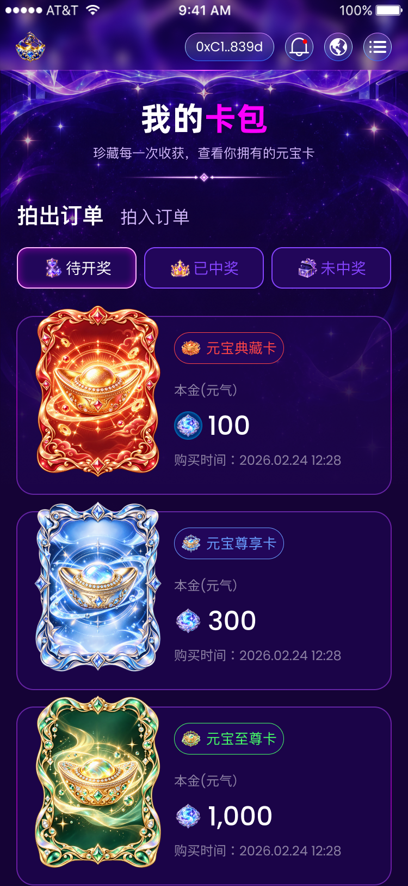

# 我的卡包实现清单（已确认）

## 范围

- 目标：还原 Figma `NVwAAv12WZx1LiCTqPMNWD` / `30183:311` 的我的卡包页面，完成两组 Tab、本地分页上拉加载和下拉刷新，并接入首页及侧栏卡包入口。
- 允许修改：新增 `src/pages/main/card-pack/`、`src/assets/card-pack/`；更新路由声明、路由注册、侧栏卡包 path、首页卡包入口点击处理；新增所需颜色变量、页面文档与行为测试。跨页共同使用的元气和分隔图可迁入 `src/assets/common/`，原首页仅更新 import。
- 明确不做：API、ABI、钱包资产和交易逻辑、新依赖、公共 Header 或刷新组件结构重写、其他页面视觉、远程 Git 操作、Logo 构建门禁修改。
- 依据：指定节点的 Figma MCP 数据、Figma REST 原始图层属性、整画板导出图、开发者下载资源、PROJECT_TERMS.md、布局/路由/刷新组件文档。原始属性摘要另存 `docs/design-reference/yuanbao-card-pack-measurements.json`，用于保留精确浮点颜色和图层信息。
- 工作区已有首页、侧栏、Header、路由及主题等未提交改动，必须保留，只在上述入口及 token 位置做必要增量。

## 画板与公共外壳

画板 750×1624。顶部 28px 设备状态栏不实现，也不预留高度；页面视觉对照视口为 750×1596。以下坐标是原始画板坐标，浏览器 H5 对照 y 减 28。公共 Header 保持既有 100px 高和现有交互；不伪造连接地址。750px 原始样式值交给现有 px-to-vw 流程，小数不手动缩放或取整，1px 边框仍保留真实像素。

## 图层量测

以下尺寸、行高和字距均来自原始属性；不是截图估算。表中十六进制颜色是便于阅读的摘要，精确颜色保存在原始属性摘要，尤其卡名红/蓝/绿与标题强调色的浮点通道不能误写为别的主题色。

| 区域 | Figma 实测 |
| --- | --- |
| 画板背景 | `#150336` |
| 星空背景 | x1/y0，749×888；图层图像 STRETCH、曝光 -0.07999999821186066；同层 180° 渐变：`#150336` 20%透明度在 20.000000298023224%，到 100% 处完全不透明。需要核对手动导出是否已包含图层曝光及叠层，避免重复施加 |
| 标题 | x257/y175，237×82；Alibaba PuHuiTi Bold700，字号60，行高82.31999969482422，字距0；“我的”白色，“卡包”强调色摘要 `#FB00FF` |
| 标题阴影 | x0/y4，模糊10，黑色30.000001192092896% |
| 说明 | x171/y263，408×34；PingFang SC400，字号24，行高33.599998474121094，字距0；`#D1B7FB`，同标题阴影 |
| 分隔图 | x206/y313，338×24；复用既有真实图片 |
| 拍出订单（选中） | x31/y367，160×56；PingFang SC600，字号40，行高56，白色，字距0，同标题阴影 |
| 拍入订单（未选中） | x221/y375，128×45；PingFang SC400，字号32，行高44.79999923706055，`#D1B7FB`，字距0，同标题阴影 |
| 订单类型间距 | 第一项文字框右缘191，到第二项起点221，间距30；顶部偏移8来自图层坐标 |
| 状态 Tab 整组 | x31/y453，688×76；三列，每列220，gap14 |
| 状态 Tab | 220×76，圆角20，背景`#22065A`；padding上下16/左右20，图标与文字gap4；2px内描边 |
| 状态选中 | 白色描边与文字；inset阴影0/0/20，`#FB00FF`60.00000238418579% |
| 状态未选中 | 描边与文字`#8644FF`；不应用未启用的 Figma 阴影 |
| 状态图标 | 各40×40；待开奖沙漏、已中奖皇冠、未中奖宝箱 |
| 状态文字 | PingFang SC400，字号28，行高39.20000076293945，字距0；三项文字框各84×39 |
| 列表 | x30/y559，693×1064；三项组各693×348，gap10；组起点y559/917/1275 |
| 订单底框 | 组内x0/y20，690×328；圆角32，2px内描边；背景`#22065A`50%；纵向描边`#AB44FF`→`#FB00FF`→`#AB44FF`，色标0/50/100%，整体透明度50% |
| 卡牌 | 画板x60；红240×316、蓝240×318、绿240×316；各组y0，突出底框上边20px；使用真实共享卡图，不重绘 |
| 卡名胶囊 | 组内x290/y50，202×58；背景`#22065A`，圆角999，1px内描边；上下padding10/左右12，gap10 |
| 卡名图标 | 红/蓝/绿各36×36；来自本次下载资源 |
| 卡名文字 | PingFang SC400，字号26，行高36.39999771118164，字距0；文字框130×36；红/蓝/绿颜色摘要`#FF4545`/`#699EFF`/`#45FF67`，描边同色 |
| 本金内容组 | 组内x290/y139，403×164，纵向gap10 |
| 本金标签 | Poppins400，字号24，行高36，字距0，白色50%；原文“本金(元气）” |
| 本金金额行 | 标签后gap10，行高72；元气图标52×52，图标到数值gap10 |
| 本金数值 | Poppins500，字号48，行高72，字距0，白色；设计文本100/300/1,000；文字框宽79/90/120 |
| 购买时间 | 数值后gap10；Poppins400，字号24，行高36，字距0，白色50%；设计文本“购买时间：2026.02.24 12:28”，文字框308×36 |

红卡本金行存在两个重叠图层：`30204:1318` 为52×52已有元气图片，`30204:4276` 为同位置52×52组合Frame（内部图片实际48×48，含不同底形及内阴影）。必须使用完整组合导出核对原稿；不能只把首页元气图片当成相同成品。蓝/绿行使用现有元气图。

## 已下载资源与目标路径

| 来源 | 尺寸 | 语义路径 |
| --- | --- | --- |
| Downloads/image 4906.png | 749×888 | `src/assets/common/account-background.png`（资产页复用后提升至common） |
| Downloads/image 4904.png | 40×40 | `src/assets/card-pack/status-pending.png` |
| Downloads/image 4904 (1).png | 40×40 | `src/assets/card-pack/status-won.png` |
| Downloads/image 4904 (2).png | 40×40 | `src/assets/card-pack/status-lost.png` |
| Downloads/image 4920.png | 36×36 | `src/assets/card-pack/card-red-emblem.png` |
| Downloads/image 4919.png | 36×36 | `src/assets/card-pack/card-blue-emblem.png` |
| Downloads/image 4918.png | 36×36 | `src/assets/card-pack/card-green-emblem.png` |

已核对七张文件存在及尺寸，三个状态图标已目视确认对应关系。共享红/蓝/绿卡牌分别在 `src/assets/common/card-red.png`、`card-blue.png`、`card-green.png`，自然尺寸320×422/320×424/320×422；首页元气图80×80、分隔图338×24可复用并归档common，不能按文件自然尺寸代替新页面图层显示尺寸。

已补齐：红卡本金组合图标 `30204:4276`，完整Frame导出52×52，语义路径 `src/assets/card-pack/energy-red.png`。该图只用于红卡本金行，不用于红卡名称徽章。

## 正常流、复用与页面特例

- 正常流顺序：标题 → 说明 → 分隔图 → 订单类型Tab → 状态Tab → 分页列表 → 共享加载页脚；用margin/padding/gap表达源图层间距。
- 订单类型采用文本Tab语义，状态Tab采用带图标的真实button，支持焦点和键盘；现有SegmentedTabs默认带主题胶囊渐变，需评估其文档支持的纯文字适配是否满足订单类型，不为了该页改变公共组件契约。图标状态组与公共渐变胶囊视觉不同，用页面本地组件保持实测内阴影和边框，不引入设计外动效。
- 单项订单采用Grid：左侧真实卡图，右侧卡名胶囊、本金、时间；底框用正常流层叠Grid作为整行背景，卡图不以absolute定位。
- 复用MainLayout、HeaderBar、SidebarMenu、PagePullRefresh、usePageRefresh、usePageLoadMore、Empty、DropletLoading、路由导航封装与必要Toast。
- 复用`.flex`、`.flex-column`、`.items-center`、`.flex-center`、`.tc`。渐变底框可使用`gradient-card`传入精确颜色与宽度；共用元气与分隔图只保留一份。
- 唯一页面定位特例是`background-art`星空装饰，覆盖公共Header后方，不承担正文布局，按规范添加layout-exception标记。红卡专用图标使用完整导出，不在HTML重建其装饰图层。
- 既有主题颜色优先复用，新增重复状态颜色与所需渐变集中到color.scss，不替换全局主题或其他页面颜色。

## 分页及刷新方案（已确认的静态阶段）

项目当前未提供卡包API契约。本阶段拟使用明确标记的本地设计示例数据，实现可交互分页与刷新；不虚构请求地址、资产来源、中奖规则或后台分页字段。只读展示数据来自设计，演示数据不代表用户资产。

- 首屏顺序与三张卡内容严格按原稿。演示分页来源和每页数量需在实现时明确记录，不能无限复制订单制造真实资产假象。
- 两组Tab变化时，同步重置列表、游标、hasMore=false和加载门控，再await第一页加载；只有其结果可以重置hasMore。
- 下拉刷新await本地数据源第一页的实际重新加载并写入页面，不只递增version，也不以空回调假装刷新。
- 上拉加载await下一页并追加；初始/替换第一页期间enabled=false；快速Tab切换及卸载丢弃过时响应，避免旧页追加到新筛选。
- 公共观察器沿用每次注册后由新scroll事件启用的机制，不能复用历史window.scrollY自动请求下一页。
- 加载指示通过`loadingIndicator: 'droplet'`复用共享组件，无可见加载中文字；`showNoMore: items.length > 0`，空第一页只显示Empty。
- 后续真实接口联调需要独立提供API Markdown，确认订单类型/状态、分页协议、时间和金额字段后替换本地数据源。

## 字体与设计缺口

原稿需要Alibaba PuHuiTi Bold700、Poppins Regular400/Medium500和PingFang SC。项目及Downloads未找到Alibaba PuHuiTi/Poppins字体文件，系统字体中也未发现这两类。现有抢拍页采用此前开发者批准的微软雅黑默认；延续该字体会产生字形差异，不能称为严格1:1。

开发者已明确批准本页默认微软雅黑，替换原稿字体为已批准的设计差异。字体之外，表中尺寸、行高、字距、颜色与图层布局均已有实测来源，无需目测估算。

设计只给出“拍出订单/待开奖”画面，没有其他筛选状态画板。其它Tab拟沿用同一结构及相同选中视觉，只演示切换与列表重置，不从此图推导真实中奖或订单字段。

后续开发者补充拍入节点`30204:4176`，其增量量测、三订单入口、本金组合与资源复用决定见`yuanbao-card-pack-incoming-checklist.md`。拍入/待开奖现具有独立设计示例，其余未提供记录的筛选继续使用Empty；上述最初设计缺口不再适用于拍入/待开奖。

释放节点`30204:4308`后续已提供并确认，进行中收益卡、独立状态组、指标布局与验收见`yuanbao-card-pack-release-checklist.md`；释放/进行中不再使用缺少设计时的空态，已完成仍待独立数据。

## 验收计划

- `git diff --check`、`pnpm exec tsc -b`、`pnpm lint`、`pnpm test`、`pnpm build`；既有Logo未就绪门禁保留，构建若被阻断如实记录。
- 750×1596截图对照与DOM几何核对；375×798检查比例、图片尺寸、文字、焦点、触摸操作和无横向溢出。每张静态图确认非空、本地引用、设计槽位、成功加载和有效显示尺寸。
- 首页/侧栏入口到`/card-pack`，侧栏正常关闭及恢复滚动；公共Header交互保持现有行为。
- 验证Tab切换、重复下拉、末页、空列表、快速切换、过时结果、刷新与分页竞争；验证IntersectionObserver与fallback不会凭历史滚动触发新数据集第二页。
- 验证列表追加一次、刷新替换第一页、hasMore边界和loading清理；测试业务行为，不用大量静态样式断言代替视觉验收。

## 当前进度

已完成设计读取、精确属性补齐、页面实现、入口接入、本地分页与刷新，以及双尺寸浏览器验收和回归测试。原始字体替换按开发者确认执行；真实API联调待后续文档。

## 开发者确认与实现决定

- 开发者于2026-09-28确认清单，并明确本页默认微软雅黑；字体替换为批准的设计差异，保留原始字号、字重、行高、字距。
- 缺少的红卡本金组合Frame由已明确核对的30204:4276导出，实际52×52，与现有元气图不同。
- 默认拍出/待开奖采用两页有限设计样本，每页3项；第二页只重复设计示例以验证追加，内部ID独立；其它未提供数据的Tab显示Empty，未编造中奖资产。
- 两组Tab均复用SegmentedTabs，使用其已支持的隐藏底板适配，复用按钮、键盘和焦点。
- 背景框采用正常流Grid层叠；精确渐变描边使用仅负责装饰的background-art伪元素，不把文字或卡图绝对定位。
- 桌面常驻滚动条占用15px导致居中差异与vw横向溢出；页面私有SCSS通过html:has(.card-pack-page)仅在卡包路由隐藏滚动条，继续使用真实window滚动，不影响其它路由或公共组件。

## 验收记录（2026-09-28）

- 750×1596：标题x257/y146.992、237×81.992；状态组x30.992/y424.969、688×75.992；列表x30/y530.961、693×1063.961；底框690×327.992，卡图240×315.992/318/315.992，卡名202×58、图标36×36，元气图52×52。目标源坐标减28后误差在0.08px以内，属于现有vw换算精度。
- 375×798：文档宽与clientWidth均375，无横向溢出；状态组344×37.992，卡片组346.5×173.992；13张正文img全部成功加载，星空背景存在且可见。字体族声明为Microsoft YaHei/微软雅黑/sans-serif，平台没有该字体时走sans-serif回退。
- 订单类型按钮保持160px可点击框，未选中文字仍为32px、原128px字形宽度和源位置；切换选中项不会让两个入口横向跳动。
- 首次滚动从3条追加到6条，只有两页，结束文案出现；切换中奖状态/订单类型同步清空列表，Empty不带结束文案；恢复默认Tab仅加载第一页3条，不凭历史滚动自动追加。共享键盘ArrowRight/Home已验证。
- 首页箭头及侧栏卡包入口真实点击到/h5/card-pack，页面滚动归零，侧栏卸载，body overflow恢复；首页共同使用的图片加载正常。Header结构及钱包未连接状态保持现有实现。
- 新增12项行为测试覆盖替换第一页门控、追加防重、旧Tab第二页丢弃、快速切换及旧错误丢弃、刷新等待并替换、失败重试、卸载失效、有限示例数据，以及共享观察器/fallback每次注册后仅由新scroll启用。下拉触摸处理器通过运行真实PagePullRefresh组件验证，只执行一次并持续等待实际加载Promise；未进行实体手机触摸验收。
- pnpm lint、pnpm exec tsc -b、git diff --check通过；pnpm build前置的240项测试全部通过，随后被既有Logo未就绪门禁阻断。生产构建未完成，没有绕过门禁。
- 浏览器warn/error为空。截图保存在docs/design-reference/yuanbao-card-pack-750.jpg、yuanbao-card-pack-375.jpg。截图工具实际返回JPEG，因此使用jpg扩展名，不将其冒充无损PNG；颜色核对同时以Figma原始属性及CSS计算值为依据。
- 手动导出的背景与原稿非文字区域像素读取相符，已包含图层叠层效果，不重复添加曝光或渐变；默认字体字形与公共Header几何是已记录的设计差异。
