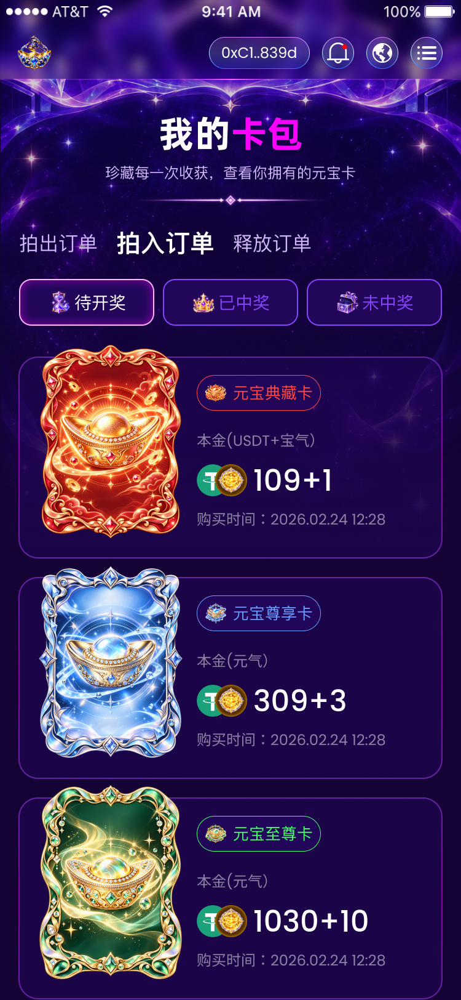

# 卡包拍入订单增量实现清单

## 范围

- 目标：按 Figma `NVwAAv12WZx1LiCTqPMNWD` / `30204:4176` 补齐现有 `/card-pack` 的拍入订单/待开奖画面，完成真实 Tab 点击、有限本地分页与下拉刷新，750px画板宽度下核对可量测几何与图片槽位。
- 允许修改：`src/pages/main/card-pack/` 的页面、私有SCSS、本地预览数据与类型；本清单、原卡包清单、模块README、设计参考及卡包聚焦行为测试。复用common币种图片，不新增实施切图。
- 明确不做：真实订单、释放规则、API/ABI、金额计算、钱包交易、新依赖、公共Header/SegmentedTabs/刷新组件结构变更、路由变更、资产或团队页改动、全局主题更换、Logo门禁与远程Git操作。保留现有其它未提交改动。
- 事实依据：指定节点的MCP数据、REST完整原始属性、完整画板参考图、既有卡包代码及人工资源。字体沿用开发者已确认的默认微软雅黑。
- 验证：`git diff --check`、`pnpm exec tsc -b`、`pnpm lint`、卡包聚焦测试、`pnpm test`、`pnpm build`；750×1596与375×798浏览器截图、图片加载与几何、三入口切换、快速切换隔离旧响应、下拉等待与分页边界。Logo未就绪若继续阻断生产构建，保持门禁并如实报告。

开发者明确指出这是两个币种的叠加效果，要求复用资产页已下载的相关图标。本次按该指示解除组合资源缺口，使用已有USDT、宝气图标，各52×52、错开30px，以正常流Grid叠加为82×52；继续完成已声明的卡包增量，不再次索要组合切图。

## 设计证据

原始完整节点保存在 `docs/design-reference/yuanbao-card-pack-incoming-measurements.json`。以下均为Figma图层实测属性，不是截图估算。画板750×1624；28px设备状态栏不实现、不预留，浏览器750×1596对照时源y减28。保留750px源尺寸供现有px-to-vw处理。

## 精确量测与增量差异

| 区域 | 实测属性 / 处理 |
| --- | --- |
| 订单入口整组 | `30204:4302`，x31/y367、476×56，横向gap30、垂直居中 |
| 拍出订单（未选中） | x31/y372.5，128×45；PingFang SC400，字号32、行高44.79999923706055、字距0；#D1B7FB |
| 拍入订单（选中） | x189/y367，160×56；PingFang SC600，字号40、行高56、字距0；白色 |
| 释放订单（未选中） | 新入口，x379/y372.5、128×45；字体与未选中拍出相同 |
| 入口阴影 | 0/4/10px，黑色30.000001192092896%；复用已有文本阴影token |
| 状态组 | x31/y453、688×76；220px三列、gap14；上下padding16、左右20、图文gap4；圆角20、2px内描边、#22065A背景 |
| 状态文字 / 图标 | PingFang SC400、字号28、行高39.20000076293945、字距0；三图标各40×40；选中白色描边和文字，inset 0/0/20 #FB00FF60.00000238418579%；未选中#8644FF |
| 列表 | x30/y559，组三项693×348，gap10，y559/917/1275；底框宽690高328，组内y20，圆角32；沿用现有Grid结构 |
| 底框颜色 / 描边 | #22065A50%；2px内纵向渐变描边，#AB44FF→#FB00FF→#AB44FF，色标0/50/100%，透明度50%；保留原始浮点通道 |
| 卡牌 | 组内x30/y0，红/绿240×316、蓝240×318；使用现有common三张卡图 |
| 卡名 | 组内x290/y50、202×58；上下padding10、左右12、gap10；图标36×36；文字26/400/36.39999771118164、字距0；1px同色内边框、圆角999、#22065A背景；红/蓝/绿精确颜色沿用已有token |
| 本金信息组 | 组内x290/y139、403×164；纵向gap10；标签36px高、金额72px高、时间36px高 |
| 本金标签 | Poppins400、字号24、行高36、字距0，白色50%；红卡“本金(USDT+宝气）”，蓝/绿“本金(元气）” |
| 双币组合 | 三张均82×52；两枚图标各52×52，第二枚组内x30，因此重叠22px；第一枚USDT，第二枚宝气；金额行内垂直居中 |
| 宝气图标内部 | 52px圆形底层，底色原始rgb(32.0068359375% 17.09681749343872% 0%)；inset 0/0/6px，rgb(100% 71.66666388511658% 0%)；内部image4905为48×48、x2/y2，imageRef为6fd5948d2108ae0c76124bedf0956b8cc6b1e853 |
| 金额 | 组合图标后gap10，即画板x412；红109+1、蓝309+3、绿1030+10；Poppins500、字号48、行高72、字距0、白色；源文字框宽130/153/189，字体替换后不以源文字宽强拉伸字形 |
| 时间 | “购买时间：2026.02.24 12:28”；Poppins400、字号24、行高36、字距0、白色50% |

标题、说明、分隔图、背景及公共外壳与已实施卡包稿对应：标题x257/y175、237×82，60/700/82.31999969482422；说明x171/y263、408×34，24/400/33.599998474121094；分隔图x206/y313、338×24；背景x1/y0、749×888，#150336画板底色。继续复用同一套原始颜色、阴影与已包含叠层效果的背景图片，不重复添加曝光/渐变。共同属性详见原卡包清单及本次完整JSON。

与现有实现的重要差异：现代码两个入口都使用160px点击框，因此拍入选中时x221；新稿拍入选中实际x189。需按本次128/160/128和30px gap实现拍入画面。原拍出稿未选中的拍入文字y375，当前新稿两项未选中文字y372.5；以不同选中状态的源稿分别适配，保留拍出既有已验收位置，不把5.5px垂直偏移错误称作8px。

## 资源核对与开发者复用决定

| 资源 | 目标 / 状态 |
| --- | --- |
| 星空、分隔图、三张卡牌 | common中已存在，复用，不重新下载 |
| 状态沙漏/皇冠/宝箱、三枚卡名徽章 | card-pack中已存在，复用 |
| 本金USDT | `src/assets/common/token-usdt.png`，已有40×40导出；按新稿显示52×52，三张卡复用 |
| 本金宝气 | `src/assets/common/token-baoqi.png`，已有40×40导出；按新稿显示52×52，三张卡复用 |

现有币种图片自然尺寸40×40，开发者已明确要求复用资产页图标。叠加容器与外部槽位严格采用新稿82×52和30px错位；内部40px宝气导出放大后，其2px边距/36px内图/6px阴影比例与52px新稿内部有细微差异，属于本次明确的资源复用决定，不宣称是52px图层重新导出。直接引用现成图片，不在HTML重画矢量或阴影。现有 `card-pack/energy-red.png` 是蓝色元气组合图，仅保留拍出用途，不误用为宝气。

只下载了整画板参考图用于验收，没有将它当实施图片，也没有新增实施切片。所有正文币种img使用本地公共路径。

## 语义与复用

- 正常流保持Hero → 订单入口Tab → 状态Tab → 列表 → 公共分页页脚；沿用Flex/Grid，不使用绝对定位排正文。
- 三个入口与三个状态都复用SegmentedTabs的真实button、受控值、键盘与焦点；私有SCSS仅适配文字尺寸和源位置，不修改共享控件布局契约。
- 列表保留ul/li、卡名h2、本金与时间p；双币组合为82×52的装饰span，内部两个img以Grid叠加，金额仍为独立文字。图标叠加没有新增absolute定位。
- 复用`.flex`、`.flex-column`、`.items-center`、`.flex-center`、`.tc`和已有`hide-scrollbar` mixin；继续用当前Grid底框及仅装饰的描边例外，不引入新的公共布局或mixin。
- 保护MainLayout/Header、侧栏、路由、PagePullRefresh、Empty、DropletLoading与所有共同资源。公共颜色已有，预计无需新增全局token。

## 本地数据与交互

- 拍入/待开奖首屏红蓝绿三条，数值直接保留原稿109+1、309+3、1030+10，不拆成金融计算或推导汇率。类型按本地展示需要表达本金标签、图标类型和金额字符串，不定义未文档化的后端DTO。
- 沿用此前确认的有限两页演示：每页三条，第二页复用该组设计样本、内部ID独立；不代表真实资产。
- 拍出/待开奖仍使用既有100/300/1,000及单币图标。新增释放入口只实现Tab切换和共享Empty，不从名字推导释放操作、周期或奖励；拍入中奖/未中奖也没有独立设计数据，保持Empty。
- 原稿蓝绿标签与双币图标含义不一致，本阶段逐项保留原文与数值，记录差异，不自作主张统一成USDT+宝气。
- 复用既有分页控制器：切换先同步清空列表/游标/hasMore和门控再加载第一页；过时响应丢弃。usePageRefresh等待真实本地重载；usePageLoadMore首页加载时禁用、hasMore=false，新增scroll后才启用观察；droplet无加载文字，非空末页才显示“没有更多了”。
- 默认进入仍为现有拍出/待开奖，点击拍入展示本次节点；不新增路由，不改变首页/侧栏入口。

## 已知差异与实现决定

1. 字体继续默认微软雅黑，批准的字形差异保持；尺寸、行高、字距仍用实测值。
2. 原稿包含第三个“释放订单”入口，本增量只实现其切换/空态。其选中态及内容没有来源画板，选中样式复用已有40px白色文字规则，不声称为独立释放画板量测结果。
3. 开发者要求复用资产页USDT/宝气两张图片叠加，按上述决定实施；不再要求组合切图。图标源尺寸放大带来的内部比例差异已记录。

后续开发者提供释放节点`30204:4308`并确认其增量清单，释放入口现改为独立进行中/已完成状态与收益卡，详见`yuanbao-card-pack-release-checklist.md`。本清单中释放空态和选中态推导的描述仅代表该节点提供前的实现阶段。

## 验收记录（2026-09-28）

- 已完成拍入本地样本、逐卡本金标签、双币Grid叠加、释放入口与空态；既有分页控制器、公共刷新组件和共同图片没有改写。
- 750×1596：拍出入口x30.992/y344.469、128×45；拍入入口x188.992/y338.969、159.992×56；释放入口x378.984/y344.469、128×45。对应源稿减28px后误差不足0.04px。
- 列表首项x30/y530.961、693×347.992；双币容器x320/y725.938、81.992×51.992，两图分别x320/x350、51.992×51.992，组合到金额10px，金额x411.984。后两项组起点y888.945/1246.930，未加入布局估算或absolute正文定位。
- 375×798：双币容器40.992×25.992、两枚图25.992×25.992、横向错位15px；document/client宽均375，无横向溢出。正文16张img全部加载成功，USDT与宝气引用资产页同一common文件。
- 上拉从3条追加到6条，第二页后显示“没有更多了”；释放及拍入中奖筛选显示“暂无数据”，空态无结束文案；恢复拍入/待开奖只加载三条第一页。Home/ArrowRight键盘切换、点击切换及快速拍出→拍入切换均正确，仅保留109+1/309+3/1030+10。
- 拍出仍显示100/300/1,000、单元气图标，标题、状态和卡片几何沿用既有量测。新稿资源复用与默认字体的已批准差异如上，不声称原字体或新52px图层内部艺术细节完全一致。
- 聚焦卡包/刷新14项行为测试通过；pnpm exec tsc -b通过；pnpm build的前置lint与全量252项测试通过，随后被既有Logo占位资源门禁阻断。正式生产构建未完成，未绕过门禁；git diff --check通过。
- 下拉刷新复用既有await列表重载及触摸处理器回归，未做实体手机触摸验收。浏览器warn/error为空；源码未提交、未推送。
- 截图为`design-reference/yuanbao-card-pack-incoming-750.jpg`和`yuanbao-card-pack-incoming-375.jpg`，对照原稿PNG检查；浏览器截图接口返回JPEG，因此保留jpg扩展名。验收结束已清除临时viewport override并保留卡包预览。
