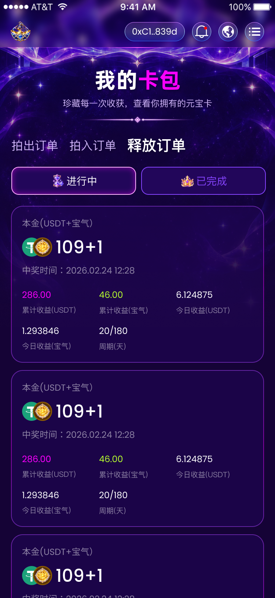

# 卡包释放订单增量实现清单（已确认）

## 范围

- 目标：按 Figma `NVwAAv12WZx1LiCTqPMNWD` / `30204:4308` 完成现有卡包“释放订单 / 进行中”画面、进行中/已完成切换、本地有限分页与下拉刷新；保留此前拍出、拍入独立画面。
- 允许修改：`src/pages/main/card-pack/` 页面、私有SCSS、类型、本地设计数据与必要分页类型适配；`src/styles/color.scss`仅补充尚未存在的重复宝气累计收益颜色，必要时更新样式README；卡包README、三份卡包清单、设计参考及卡包聚焦行为测试。
- 明确不做：真实收益/周期计算、释放或领取操作、API/ABI、交易、钱包资产、新依赖、路由或共同Header/SegmentedTabs/PagePullRefresh结构变更、其它页面、全局主题方向变更、Logo门禁、远程Git操作。保留工作区其它未提交改动。
- 依据：指定节点MCP、REST完整原始图层属性、画板PNG；既有卡包及资产页公共资源；AGENTS.md、项目协作/布局/术语文档。字体继续采用开发者确认的默认微软雅黑。
- 验证：`git diff --check`、`pnpm exec tsc -b`、`pnpm lint`、卡包聚焦测试、`pnpm test`、`pnpm build`；750×1596和375×798截图对照、实际几何/图像加载、跨状态组选中值重置、快速切换/旧响应隔离、第一页加载门控、分页结束、空态及刷新等待。既有Logo门禁如果继续阻断构建，保留并如实记录。

开发者已于2026-09-28确认本增量清单，按声明范围实施。所需实施资源已齐，不要求新增导出。

## 设计证据与源尺寸

完整原始属性保存于`docs/design-reference/yuanbao-card-pack-release-measurements.json`。画板750×1624，不实现28px手机状态栏、不预留高度；浏览器对照视口750×1596，以下源坐标y减28。样式使用750px源值交给现有px-to-vw，不人工折半或取整。可精确读取的属性全部来自图层，不根据截图估算。

## 精确量测

| 图层 / 区域 | 原始实测属性 |
| --- | --- |
| 星空图层 | x0/y0、750×888，STRETCH；imageRef461a0a4a62e81c49a30424de16ac13d2192a1665；cropTransform纵向scale0.5374268889427185、offset0.22116726636886597；深紫20%→100%纵向覆盖，与已导出背景为同一原图但宽度/裁切有微小差异 |
| 标题 / 说明 / 分隔图 | 与现有卡包一致：标题x257/y175、237×82，字号60/700/行高82.31999969482422；说明x171/y263、408×34，24/400/33.599998474121094；分隔图x206/y313、338×24；字距0、既有0/4/10黑30%文字阴影 |
| 订单入口整组 | x31/y367、476×56，gap30、垂直居中；非选中拍出x31、拍入x189，均128×45、y372.5；选中释放x347/y367、160×56 |
| 订单文字 | 非选中32/400/44.79999923706055、#D1B7FB；选中40/600/56、白色；PingFang SC、字距0、同标题阴影 |
| 释放状态整组 | x31/y453、694×76；两项340×76、gap14，第二项x385；原三项开奖状态在释放模式不显示 |
| 状态内容 | padding上下16、左右20，图文gap4；图标40×40；PingFang SC28/400/39.20000076293945、字距0；文字84×39 |
| 状态背景及边框 | #22065A，圆角20、2px内描边；进行中选中白色边框/文字，inset0/0/20、#FB00FF60.00000238418579%；已完成未选中#8644FF，关闭未启用的阴影 |
| 释放列表 | x30/y559、690×1318；原稿三条、各690×426，gap20；三条起点y559/1005/1451；第三条内容超过画板裁切边界，浏览器保留正常流滚动显示 |
| 收益卡底框 | 690×426、圆角32；背景原始#22065A50%；2px内纵向渐变描边#AB44FF50%→#FB00FF50%→#AB44FF50%，色标0/50/100%；复用卡包既有底框颜色与描边装饰 |
| 卡内本金组 | x30/y30、403×164，纵向gap10；相对画板首项x60/y589 |
| 本金标签 | “本金(USDT+宝气）”；Poppins24/400/36、字距0，白色50%；文本框403×36 |
| 本金金额行 | 组内y46、行高72；双币组合82×52，两枚52px图标相错30px、重叠22px；图标到金额gap10；金额“109+1”，Poppins48/500/72、白色、字距0，原字形框130×72 |
| 中奖时间 | “中奖时间：2026.02.24 12:28”；组内y128；Poppins24/400/36、字距0，白色50%；保留“中奖”原文，不复用普通卡的“购买时间”标签 |
| 第一排指标 | 组内x30/y224，620×74；三列200px、gap10；值先于标签，左对齐 |
| 累计收益USDT | 值“286.00”，原始rgb(98.333340883255% 0% 100%)，复用已有标题强调色；值Poppins24/400/36；标签“累计收益(USDT)”PingFang SC20/400/28，白色50%；值与标签gap9，该列高度73 |
| 累计收益宝气 | 值“46.00”，#B7FF2D（原始rgb(71.76470756530762% 100% 17.64705926179886%)）；值24/400/36；标签“累计收益(宝气)”20/400/28、白色50%；gap10、列高74 |
| 今日收益USDT | 值“6.124875”，白色；24/400/36；标签“今日收益(USDT)”20/400/28、白色50%；gap10、列高74 |
| 第二排指标 | 组内x30/y322，410×74；两列200px、gap10；第一排74px高度后垂直gap24；与底框下缘距30 |
| 今日收益宝气 | 值“1.293846”，白色；24/400/36；标签“今日收益(宝气)”20/400/28、白色50%；gap9、列高73 |
| 周期 | 值“20/180”，白色；24/400/36；标签“周期(天)”20/400/28、白色50%；gap10、列高74。原稿是文字值，没有进度条，不额外生成进度条或计算百分比 |

所有指标字距0、无额外文字阴影。三个订单的本金、中奖时间、五项指标相同，均直接来自各自源图层，不推导业务收益公式。数值保留字符串和末尾零，不启用金融计算或新动效。

## 资源、字体与已授权复用

| 资源 | 现有路径 / 使用方式 |
| --- | --- |
| 星空 | `src/assets/common/account-background.png`；复用既有完整图，不追加Figma叠层。释放槽位按新稿x0、750×888，原资源749×888；1px宽度及微小裁切差异作为复用差异记录，不称为新图层独立重导出 |
| 标题分隔 | `src/assets/common/title-divider.png`，338×24 |
| 进行中图标 | `src/assets/card-pack/status-pending.png`；与新稿沙漏imageRef及cropTransform一致，显示40×40 |
| 已完成图标 | `src/assets/card-pack/status-won.png`；与新稿皇冠imageRef及cropTransform一致，显示40×40 |
| USDT及宝气 | `src/assets/common/token-usdt.png`与`token-baoqi.png`；沿用开发者“两个币种叠加、资产页已下载”指示，52×52、错位30px，Grid叠加。40px自然图片放大带来的内留白/阴影比例差异按拍入清单已记录的复用决定处理 |

释放画面没有三色卡牌或卡名徽章，不把原普通订单卡的艺术图和标题胶囊塞进收益卡。资源齐全，无需组合切图或新占位图片。默认微软雅黑替换原稿Alibaba PuHuiTi/Poppins/PingFang SC的字形差异继续保留，源字号、字重、行高、字距不改变。

## 语义、正常流与共享复用

1. 顺序保持Hero → 订单类型Tab → 当前模式状态Tab → 当前模式分页列表 → 公共页脚。
2. 订单类型继续SegmentedTabs；释放时使用独立受控的“进行中/已完成”SegmentedTabs和对应tabpanel语义，私有样式每项340px。拍出/拍入继续原三项“待开奖/已中奖/未中奖”。保护共同组件焦点、方向键及即时onChange。
3. 收益卡使用ul/li/article；卡内本金/金额/中奖时间为p，五指标使用dl和合法dt/dd配对，Flex让dd数值视觉上位于dt标签上方；指标Grid三列各200px、gap10，第二排两列，使用真实源间距。
4. 可抽取页面本地双币装饰组件，在拍入和释放两处引用相同Grid叠加与两张图，不建立全局币种业务组件；普通订单和释放订单使用本地判别类型，避免给收益卡填虚构的卡名或颜色字段。
5. 复用已有PagePullRefresh、usePageRefresh、usePageLoadMore、DropletLoading、Empty、Toast、`.flex`、`.flex-column`、`.items-center`、`.tc`与`hide-scrollbar` mixin。卡底框继续正常流Grid层叠和现有装饰性渐变描边，不需要新mixin或新定位例外。
6. 星空及边框伪元素继续仅负责background-art装饰，保留layout-exception注释，不靠absolute安排收益正文。图标叠加用Grid，不新增absolute。
7. 已有底框/文本/选中状态颜色直接复用；仅缺失的#B7FF2D重复累计收益色增量进入color.scss，沿用原始浮点通道，不替换其它绿或主题。

## 本地数据、状态隔离与刷新分页

- 释放设计只提供进行中三条。继续已确认的有限预览方式：每页3条，第二页重复该组源样本、ID独立，最多6条，用来验证上拉追加；已完成没有来源记录，切换后共享Empty，不把进行中收益当成完成收益。
- 三订单类型仍从同一路由进入，初始默认拍出/待开奖；进入释放时默认进行中。释放与普通订单的状态枚举分开表达：跨状态组同步重置到目标有效默认值、清空列表/页码/hasMore和加载门控，再加载第一页，避免把won/lost误传为释放状态。普通拍出↔拍入兼容原开奖状态时沿用现有切换行为。
- 快速释放→拍入、进行中→已完成、刷新与加载更多交错时，沿用generation丢弃过时结果；在首页加载期间usePageLoadMore关闭、hasMore=false，不能继承上一组历史scroll立即加载下一页。
- usePageRefresh继续await当前有效查询第一页真实本地重载；初始及追加加载时禁用。上拉采用公共droplet，无可见加载文字；showNoMore由渲染条目数量决定，已完成空态不显示“没有更多了”。
- 数据均为设计示例，不是用户资产/收益，不定义释放或领取按钮，不发远程请求。后续真实接口需独立API Markdown确认状态、分页、本金、收益及周期来源。

## 验收重点

- 释放选中x347、两状态宽340、列表宽690高426、上下指标位置及9/10px不同gap；两排指标五个值全部可见。
- 375px无横向溢出，底部第三条可滚动完整查看，五项标签不重叠，双币素材完成加载且槽位正确。
- 释放→拍入→拍出及相反切换，状态组数量/标签和记录类型一致，不混入上一类型记录，原两画面保持既有验收几何。
- 进行中有限两页、已完成空态、替换第一页加载门控、快速切换、末页及等待刷新完成；两种公共观察器arming逻辑继续由现有回归覆盖，不更改共同组件。
- 页面截图与量测、测试结果及真实构建限制记录在此清单。

## 验收记录（2026-09-28）

- 已完成释放进行中收益卡、两项状态切换、判别查询/记录类型、有限本地分页与刷新；双币复用页面本地组件和common文件，无新切片、依赖、接口或共同组件结构改动。
- 750×1596：释放入口x346.992/y338.969、159.992×56，状态两项x30.992/x384.984、y424.969、339.992×75.992；对应源稿去除状态栏后误差不足0.04px。
- 列表x30/y530.961、690×1318，三卡各690×426、起点y530.961/976.961/1422.961，gap20；本金组x60/y560.961、402.992×163.984；双币容器81.992×51.992、x60/y616.953，两币错位30px。
- 首排数值x60/269.992/479.984、y754.945、高36；标签y799.945/800.938，高27.992，对应源9/10px间距。第二排数值y852.930、标签y897.930/898.922。紧凑列高度72.992，其余73.984，通过Grid align-items:start保留图层73/74px独立高度，不让短列被拉伸。数值颜色计算为rgb(251,0,255)、rgb(183,255,45)、白色；标签白50%，字号24/20、行高36/28。
- 375×798：列表卡345×213、gap10，x15、起点y265.461/488.461/711.461；指标列100px，紧凑列36.492高、普通列36.984高；双币各25.992×25.992、x30/x45。document/client宽均375，无横向溢出，标签不重叠；9张正文img全部完成加载。
- 小屏上拉从3条追加到6条后结束，底部记录五项指标完整可见，“没有更多了”出现；已完成只显示“暂无数据”，无末页提示。切回进行中只加载三条第一页，不凭历史滚动自动追加第二页。
- 点击当前释放类型保留已完成状态；离开释放到拍入重置待开奖，拍入仍109+1/309+3/1030+10及原普通卡；拍出仍100/300/1,000。End键能选择释放，公共Tab焦点与键盘行为保留。
- 聚焦业务新增三项：原稿释放字符串/有限分页、实际页面跨状态组重置/旧结果隔离、实际释放页面等待刷新并替换追加列表。卡包及公共刷新相关17项通过；pnpm verify最终lint及全量255项测试通过，pnpm exec tsc -b与git diff --check通过。最后CSS独立高度调整后再次pnpm lint通过，并复核750/375实际高度。
- pnpm build的前置检查和255项测试通过，随后被既有Logo占位资源门禁阻断；正式生产构建未完成，未绕过门禁。真实API/收益来源尚未对接，当前仅设计样本；实体手机触摸下拉未验收，实际页面注册及公共触摸等待链路由行为回归覆盖。
- 浏览器warn/error为空。截图保存为`design-reference/yuanbao-card-pack-release-750.jpg`、`yuanbao-card-pack-release-375.jpg`和`yuanbao-card-pack-release-bottom-375.jpg`，JPEG输出保持jpg扩展名；设计参考为PNG。最终清除临时viewport设置，保留释放/进行中预览；未提交、未推送。
