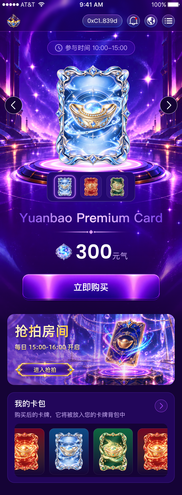

# 元宝首页实现清单

## 顶部导航图标背景更新（2026-09-30）

开发者提供三个52×52导出资源及导航栏截图。已核对 `Group 181.png` 与当前 `src/assets/common/header-language.png` 的SHA-256一致；通知改用 `Group 2085666468.png` 覆盖 `header-notification.png`；`Group 286.png` 新增为 `header-menu.png` 并替换菜单按钮原CSS渐变背景。菜单线条继续由 `MenuToggleIcon` 绘制，以保留开关动画。仅修改Header资源、菜单局部背景及布局说明；钱包、通知/语言/菜单入口顺序、点击行为、公共Header尺寸、路由和其他页面保持现状。验证750px/375px图标大小、资源显示、菜单开合及 `pnpm build`、`git diff --check`。

验证：开发预览 `/h5/showcase/components/sidebar` 可显示三个入口，菜单开合后图标恢复三线并保持按钮语义。375px视口三个按钮均约26×26，750px均约52×52；两个视口文档宽等于视口宽，无横向溢出，通知和语言图片加载成功，菜单背景指向 `header-menu.png`。`pnpm build` 通过，包含lint、302项测试、TypeScript与Vite；`git diff --check`通过。静态预览不替代真实钱包首页验收。

## 卡牌底座切图修正（2026-09-30）

开发者补充截图并指出卡牌底座已有原图，覆盖下文早期“平台采用CSS”的选择。已核对 `/Users/sly/Downloads/image 4884.png` 为690×230透明PNG，与原Figma记录的 `image 4884` / `30075:3927`、x30/y568、690×230一致。语义资源为 `src/assets/home/card-pedestal.png`；仅将首页舞台现有绝对定位装饰层的CSS椭圆、渐变、阴影替换为该图片，保留原690×230位置和卡牌/缩略图正常流布局。既有 `background-art` 定位例外继续适用。无需估算新尺寸；不改轮播交互、公共Header、全局颜色、其他页面、API或合约。验证750px设计宽与375px缩放时平台和卡牌相对位置、资源加载及无横向溢出，并运行项目构建门禁与差异检查。

本次 `pnpm build` 通过：lint、302项测试、TypeScript和Vite均成功，产物包含 `card-pedestal` 图片；`git diff --check`通过。本机无已授权钱包会话，访问 `/h5/home` 跳转 `/h5/login`，因此750px/375px实际页面截图对照尚未完成，不将源码尺寸检查写作视觉验收。

## 最新确认：入口暂未开放与卡名（2026-09-29）

依据开发者两张截图，立即购买、进入抢拍、查看我的卡包三个入口只提示“暂未开放”，保持当前首页、不导航；蓝/红/绿标题分别为Yuanbao Premium Card、Yuanbao Collection Card、Yuanbao Supreme Card。该决定覆盖本文历史入口及颜色标题说明，仅替换文字，不新增截图中的编辑器下划线。价格、轮播、图片、公共样式与其他页面不改；允许首页TSX、README、本清单、已确认首页名称PROJECT_TERMS及聚焦行为测试。验证三个入口和轮播标题、375/750无横向溢出，pnpm verify、pnpm exec tsc -b、git diff --check。

验证结果：三个入口浏览器点击均展示“暂未开放”，URL保持`/h5/home`；375px和750px下三种标题均完整且页面无横向溢出。`pnpm verify`通过（lint及264项测试）、`pnpm exec tsc -b`及`git diff --check`通过，浏览器未发现warn/error。新增首页行为回归测试；术语表已有开发者确认名称，将初始化测试中的“必须为空”断言更新为检查确认流程和词表字段，保留模板不预置业务词汇的约束。

## 开发者后续确认（2026-09-28）

开发者已补充 `image 4890.png`（338×24），并明确要求另外两块背景使用CSS边框与渐变。按此授权继续实现：平台和抢拍背景不再等待导出、不伪称与原图的艺术细节相同。下方缺失资源表保留为最初核对记录，已由本条授权解除阻塞。

### 轮播、背景及卡包后续调整

开发者进一步要求：主卡有平滑轮播效果、抢拍房间补回漏掉的背景图片、卡包内容可左右滑动。此要求替换前述“抢拍背景只用CSS”的选择；平台仍保留CSS，不调整公共Header与其他页面。

- 从已核实的Figma `30091:4663` 图片填充下载原图 `auction-room-background.png`（1840×854），按原节点的FILL采用center/cover展示到690×292，并恢复原90°紫色渐变叠层；不是其他页面的星空素材。
- 主卡使用项目既有Swiper：500ms横向位移、单卡尺寸320×424、循环切换，左右按钮/缩略图/触摸和鼠标手势/方向键同步；realIndex是当前卡状态来源，不再直接替换图片src。500ms为本次交互选择，不是Figma运动量测值。
- 减少动态效果模式速度为0，并移除卡包惯性；媒体偏好监听在卸载时清理。
- 卡包使用FreeMode鼠标与触摸拖动，左右方向键、Home/End可达首尾；删除负margin，不再裁掉首卡不可恢复的40px。初始首卡完整，末卡部分可见，以表达更多内容。
- 卡间距使用Swiper的spaceBetween，以源20/630宽的比例计算；不同时加CSS gap，避免Swiper低估内容长度而滑不到末卡。
- 允许修改：首页TSX/SCSS、对应原图、公共抢拍渐变变量、首页README及本清单。不改数据/API/ABI、公共轮播组件接口、Header、依赖或远程Git。
- 验证：750px与375px下的轮播中间帧/末帧、循环边界、缩略图联动、手势、卡包首尾可达与背景图片；`pnpm lint`、`pnpm test`、`pnpm exec tsc -b`、`pnpm build`及`git diff --check`。

## 范围与依据

- 目标：还原 Figma 首页，完成三种卡牌的本地切换、购买入口、抢拍入口和卡包横向浏览；保留已有应用外壳。
- 允许修改：`src/pages/main/home/`、`src/assets/home/`、首页所需的 `src/assets/common/` 图标、`src/styles/color.scss`、受影响的样式说明；HeaderBar 只做既有插槽的资源、控件顺序和视觉适配；必要的聚焦测试与本清单。
- 不做：接口、合约交易、鉴权、虚构目标路由、新依赖、远程 Git 操作、其他页面重构、多语言翻译解锁、Logo 就绪门禁调整。
- 依据：Figma 文件 `NVwAAv12WZx1LiCTqPMNWD` / 节点 `30064:3168`、开发者已导出 PNG、`PROJECT_TERMS.md`、`docs/ai-collaboration.md`、`docs/layout-standards.md`、首页与公共布局 README。
- 当前阶段为静态页面。设计中的价格、时间和卡包均为展示数据，不视为 API/ABI 事实；红/绿卡价格、商品名称等未提供的业务事实不编造。
- 保护工作区已有的 Header、Sidebar、WalletOrbitBorder、公共颜色和 showcase 改动，不覆盖或撤销。

## 设计对照图

整张画板由 Figma 节点导出，尺寸 **750×2038**；图片只用于对照，不作为页面实现资产。顶部 28px 为设备状态栏，H5 不实现、不预留，完整浏览器对照高度为 2010px。保留公共 Header 100px，对应设计 y28–128。下表坐标保留 Figma 源数值，除去状态栏后的浏览器 y 为原值减28。

## 资源清单

已核对 `/Users/sly/Downloads` 的文件及 PNG 尺寸；以下为复制后的目标语义路径，尚未搬运。

| 已导出文件 | 尺寸 | 项目路径 | 用途 |
| --- | --- | --- | --- |
| image 4876.png | 320×424 | `src/assets/home/card-blue.png` | 主卡牌、蓝色缩略图、卡包蓝卡 |
| image 4878.png | 320×422 | `src/assets/home/card-red.png` | 红色卡牌及缩略图 |
| image 4879.png | 320×422 | `src/assets/home/card-green.png` | 绿色卡牌及缩略图 |
| image 4881.png | 750×1332 | `src/assets/home/hero-background.png` | 首屏星空背景 |
| image 4882.png | 570×110 | `src/assets/home/purchase-button.png` | 购买按钮底图，文字使用真实 button 内容 |
| image 4891.png | 80×80 | `src/assets/home/energy-icon.png` | 元气图标 |
| image 4896.png | 250×66 | `src/assets/home/auction-button.png` | 抢拍按钮底图，文字单独实现 |
| Frame.png | 72×72 | `src/assets/home/carousel-previous.png` | 上一张 |
| Frame (1).png | 72×72 | `src/assets/home/carousel-next.png` | 下一张 |
| Frame (2).png | 32×32 | `src/assets/home/participation-clock.png` | 参与时间图标 |
| Frame (3).png | 52×52 | `src/assets/home/card-pack-arrow.png` | 卡包入口箭头 |
| Group 2085666468.png | 52×52 | `src/assets/common/header-notification.png` | 通知入口 |
| Group 181.png | 52×52 | `src/assets/common/header-language.png` | 语言入口 |
| Group 286.png | 52×52 | `src/assets/common/header-menu.png` | 菜单关闭状态资源；开启/关闭保持现有交互与动效契约 |
| 已有 yuanbao-logo.png | — | `src/assets/common/yuanbao-logo.png` | 复用现有品牌资源 |

### 最初缺少的资源（已由补充资源与CSS授权解决）

下载目录、`src/assets` 和 `public` 中未发现下列对应资源；现有星空背景不含卡牌底部平台，不能代替。

| 语义用途 | Figma 图层/节点 | 源尺寸 | 建议导出与目标路径 |
| --- | --- | --- | --- |
| 卡牌底部发光平台 | image 4884 / `30075:3927` | 690×230 | `src/assets/home/card-pedestal.png` |
| 卡牌标题下分隔装饰 | image 4890 / `30129:5071` | 338×24 | `src/assets/home/title-divider.png` |
| 抢拍房间背景 | Rectangle / `30091:4663` | 690×292、圆角29 | `src/assets/home/auction-room-background.png` |

抢拍房间背景有图片填充和左侧紫色渐变叠层。建议导出该完整矩形（不包含外部标题、时间与按钮文字），保留当前图层效果，避免重复加渐变。如导出原始图片，应明确告知，代码再按下面实测叠层实现。不自行猜测切片组合或用 CSS 绘制缺少的装饰。

## 设计量测（750px 源单位）

数值来自 Figma 图层响应。文本框高度不是显式行高，不把两者混用；工具没有返回的属性见后文。

| 区域 | 实测属性 |
| --- | --- |
| 全局背景 | `#150336`；首屏背景遮罩750/751×1332，底部渐隐从75%至100% |
| 首屏背景图片 | 图层750×1347，但开发者导出750×1332；必须按图层显示尺寸核对裁切与背景遮罩，不能只按文件高度推断 |
| Header | 背景黑色20%，背景模糊10；Header区域源高128含28状态栏；品牌图58×58，x27/y57 |
| Header右槽 | x340/y60，水平gap20；钱包、通知、语言、菜单的顺序；通知/语言/菜单52×52 |
| 钱包按钮 | 高52，padding10/20，gap10，圆角999、描边1；Poppins400/24、白色；渐变背景180°：`#CB78FD`20%/0%，`#B1CBFE`20%/50%，`#2F6CFE`20%/100%；描边180°：`#CB78FD`/0%，`#B1E7FE`/50%，`#2F6CFE`/100% |
| Header分隔 | y128、高2；-90°：`#FF5DFF`20%/40%，100%/50%，20%/60%；保持已有分隔动画机制 |
| 参与时间 | x195/y168；padding10/30、gap10、圆角999、描边1 `#AB44FF`；背景`#6815FF`20%、模糊10；图标32；PingFang SC400/26、`#D1B7FB` |
| 主卡 | 蓝卡x223/y264、320×424；按导出比例保留红绿卡的422高，不能无依据拉伸 |
| 左右切换 | x20和659、y397、72×72；底色`#150336`、白色1px描边、圆角999；导出图保留这些效果 |
| 发光平台 | x30/y568、690×230；作为非交互背景装饰置于主卡后方 |
| 缩略图面板 | x193/y708、364×122；背景`#22086E`、圆角24、描边2，白色20%/0%至10%/50%的0°渐变；内padding14/30、gap20 |
| 缩略图按钮 | 88×94、圆角20、padding10/16；图片60×79；背景`#311280`；选中描边2 `#F6DAFF`、内外发光0/0/10 `#AB44FF`；未选中白紫色20%描边1、整体opacity0.88 |
| 卡名 | x79/y860、框592×73；PingFang SC600/52；渐变270°：`#773BE6`/0%，`#FFDBFF`/50%，`#773BE6`/100%；文案`Yuanbao Premium Card` |
| 标题分隔 | x206/y943、338×24 |
| 价格行 | x223/y977，水平gap8；元气图标80×80；数值Poppins SemiBold/80、白色；单位PingFang SC400/32、`#D1B7FB` |
| 购买按钮 | x90/y1127、570×110；文案PingFang SC600/36、文字框144×50、白色、居中 |
| 抢拍房间 | x30/y1293、690×292、圆角29；叠层90°：`#5E2EB6`80%/0%，`#340093`0%/75%；正常流中距购买按钮底部56 |
| 抢拍标题 | x60/y1323、框225×78；Alibaba PuHuiTi500/57；-22°：`#FFCD48`/0%，`#FFF1BF`/25%和70%，`#FFCD48`/78%，`#FFF1BF`/100%；阴影0/4/4黑色25% |
| 抢拍时间 | x60/y1411、框270×36；Alibaba PuHuiTi500/26；0°：`#E2C472`/25%，`#FFF1BF`/76%；同上文字阴影 |
| 抢拍按钮 | x60/y1489、250×66；文字x138/y1506、框95×33；Alibaba PuHuiTi500/24；金色渐变与阴影同时间文案 |
| 卡包面板 | x30/y1615、690×373、圆角29；背景`#22065A`，描边2 `#8644FF`20%；与抢拍区域gap30 |
| 卡包标题/说明 | 标题x60/y1639、框128×45，PingFang SC500/32、白色；说明x60/y1690、框456×34，PingFang SC400/24、`#D1B7FB` |
| 卡包入口 | 面板内x608/y30，52×52；采用完整导出图 |
| 卡包滚动区域 | x60/y1744、630×220、圆角20、背景`#150336`；卡片顶部20、横向gap20；保持设计左右露出相邻卡片的裁切效果，支持横向浏览 |
| 卡包卡片 | 162×190、圆角20；图120×159，x21/y16（蓝卡y15）；红/蓝/绿180°渐变分别`#FF0004`40%→`#FFFF00`0%、`#00B7FF`40%→0%、`#00FF4D`40%→0%；白色180°20%→10%渐变描边1 |

## 公共 CSS 与组件复用

- `color.scss` 管理全局背景、品牌强调色、通用主/次文字、卡片与选择面板背景、状态/描边，以及多处重复使用的卡牌类别颜色。优先复用已有token；侧栏的相同颜色可引用统一token，保留已有侧栏变量兼容性。
- 计划统一本项目紫色背景 `#150336`、强调色 `#AB44FF`、次文字 `#D1B7FB`；`--app-text`沿用白色。全局token调整需要检查公共组件/showcase，不能只看首页。
- 按开发者要求，标题/平台/抢拍背景的艺术色值也集中为 `color.scss` 变量；首页SCSS只引用颜色变量与透明遮罩，不含裸色值，TSX也不定义色值。
- Header只调整已有左/右插槽的资源、控件顺序和外观，继续使用AppBrand、LanguageSwitch、MenuToggleIcon和已有钱包store；不重建Header。
- 复用 `.flex`、`.flex-column`、`.items-center`、`.justify-center`、`.flex-center`、`.tc`、`.container` 及现有gap工具。
- 复用 `hide-scrollbar` 处理卡包滚动；`gradient-word` 表达实测静态文字渐变；`gradient-card` 仅用于匹配的渐变按钮样式并传入项目token。
- 已检查BasicCarousel、ActionButton、GradientText。BasicCarousel的现有自动高度接口不能直接表达首页外部缩略图与左右按钮的受控联动；本地三项选择状态足够，不修改公共Carousel。ActionButton默认尺寸/渐变与导出按钮底图不符，首页使用语义button加原图底图；不改公共按钮。
- 图示文案没有已确认术语冲突；不改名、不添加未经确认的术语表规则。

## DOM、布局与本地交互

1. 正常流顺序：参与时间 → 三列Grid主卡与左右按钮 → 缩略图选择 → 卡名 → 分隔装饰 → 价格 → 购买button → 抢拍section → 卡包section。
2. 缩略图button使用`aria-pressed`；左右按钮循环切换对应卡图并同步选中项。只有蓝卡的名称/300元气在当前稿明确给出；其他类别价格与名称留TODO，不推断。
3. 购买/抢拍/卡包入口保留button，未实现目标页或交易时使用现有Toast反馈静态入口，不展示购买成功、不修改卡包余额、不注册占位路由。
4. Header语言与侧栏仍使用已有真实本地交互；通知仅静态入口，公告内容留TODO；钱包摘要来自现有store，不伪造已连接钱包。
5. 卡包使用正常流横向列表与overflow-x，默认蓝/红/绿卡展示依照设计；不会被静态购买动作修改。
6. 定位例外只允许首屏背景与发光平台这两类`background-art`，不承担正文尺寸；页面SCSS写`layout-exception`标记。卡图、缩略图、价格、按钮与卡包均不用absolute摆放。
7. 本阶段没有真实数据加载，不添加PagePullRefresh或伪刷新函数。

## 工具限制与待核对值

- 当前Figma工具返回了字体族、字重、字号与文字框尺寸，但没有显式文字行高、字间距，部分hug节点也没有最终宽高。实现时先使用normal行高/正常字距；这是工具限制下的暂定值，不是Figma实测。通过画板宽度截图对照再校正，并记录所有估算值。
- 项目未找到Poppins与Alibaba PuHuiTi字体文件；缺少字体时只能使用fallback，不能宣称字形严格一致。若要求字形一致，需要提供具有使用权限的字体文件；不擅自安装字体或联网取字体。
- 背景导出1332高与图层1347高不同，必须对照整张参考图核对显示几何，不自行把所有源值缩放。
- Figma中蓝卡x223，画板几何中心为375；主卡中心比画板中心偏8。以Grid列宽表达该实测偏置，不能用transform挪动整块内容。
- 画板末尾留白50；移除设备状态栏后仍保持底部留白。
- `PROJECT_SETUP_STATUS.md`不存在，不能据模板默认值声称已完成所有初始化；本次按用户明确要求开展首页静态阶段，不重新写入或猜测项目配置。

## 验收与验证

- 分隔资源已到位，另两块背景按开发者授权使用CSS；按本清单实现源码。
- `git diff --check`、`pnpm exec tsc -b`、`pnpm lint`、`pnpm test`、`pnpm build`；现有Logo门禁为未就绪，若构建被门禁阻断则如实汇报，不能绕过后声称正式构建成功。
- 浏览器750×2010截图与原稿（去状态栏）对照；另在375px验证缩放、文字、无横向溢出、所有资源加载与几何。
- 验证缩略图与左右按钮联动、卡包横向浏览、入口反馈、Header语言/侧栏开关，确认公共样式改动没有破坏现有侧栏。
- 如新增卡牌切换纯逻辑，聚焦测试其循环和选择联动；不编写仅镜像视觉常量的测试。

## 当前进度

已实现首页与Header内容级适配，复制原始PNG至语义路径；平台与抢拍背景按开发者授权使用CSS。菜单仍使用现有MenuToggleIcon连续开关动画，不用静态菜单PNG替换其交互动效。

### 估算与批准差异

- 页面文本行高按图层文字框高选择：参与时间36、卡名73、数值120、单位45、购买50、抢拍标题78、时间36、按钮33、卡包标题45/说明34；Header钱包30。这些是文字框约束下的实现值，不是工具返回的显式Figma行高；字距normal。
- CSS平台690×230，其椭圆边框、径向光环与阴影为近似；CSS抢拍房间保留690×292、29圆角、源紫色叠层，加入近似径向光效，省略原背景的卡牌与场景插画。
- Figma未给红绿卡商品名称和价格，使用颜色标签和破折号，不编造300元气的其他卡价。
- 未连接钱包时不显示设计示例钱包地址；Logo沿用既有Header30px水平padding与58尺寸，原稿x27属于保留公共布局的已知3px差异。
- 项目Poppins/Alibaba PuHuiTi字体缺失，使用fallback；缺少字体造成的字形差异仍保留。

## 验收记录（2026-09-28）

- `pnpm build` 前置lint和228项测试全部通过；随后被既有Logo未就绪门禁阻止，生产构建没有通过，未修改门禁。
- 最后CSS调整后 `pnpm lint`、`pnpm exec tsc -b`、`git diff --check` 通过。
- 750×2010：文档宽750；选择栏x193/y679.97/364×122；购买按钮x90/y1098.95/570×110；抢拍x30/y1264.95/690×291.99；卡包x30/y1586.94/690×372.99。对应Figma原坐标减28，误差约0.07px以内。
- 375×1005：文档宽375，无横向溢出；上一张/下一张图36×36，卡包箭头约26×26，已修正HTML尺寸属性与vw宽度混用造成的拉长。
- 17个可见img资源全部加载；星空、购买、抢拍按钮的CSS背景在截图中可见。红绿主卡保持原始422高比例，蓝卡424；缩略图和卡包图保持原始比例。
- 下一张按蓝→红→绿→蓝循环，上一张蓝→绿；点击蓝色缩略图同步主卡/选中状态/价格。未文档化的红绿价格显示破折号。
- 购买/抢拍/卡包入口分别显示待接入/待开放Toast；语言菜单正常打开关闭；侧栏开关后恢复body滚动。375px卡包横向滚动 `scrollLeft` 从0变21，再恢复0。
- 浏览器warn/error日志为空。保存375px完整截图 `docs/design-reference/yuanbao-home-375.png`，750px原生截图 `yuanbao-home-750.png` 受当前浏览器截图高度限制，仅记录顶部1724px；下部已另行现场截图核对与DOM量测。全页截图接口出现拼接比例异常，未保留异常图片，也不将其当作页面渲染结果。
- 当前浏览器标题为既有 `HU-CHINA`，未在本次首页范围修改项目命名配置。

## 轮播与背景调整验收

- 750px主卡轮播容器x223/y235.98/320×423.99，抢拍区x30/y1264.95/690×291.99，卡包gap20px；布局维持原设计尺寸。
- 轮播中间帧实测wrapper横向位移-218.537px、transition-duration 0.5s，结束-320px；验证红→绿→蓝循环、蓝卡向前到绿卡、缩略图跳转和手机375px鼠标拖动蓝→红，标题/价格/选中状态均跟随当前卡。
- 375px卡包首卡left30.992，与容器left相同；拖动到末尾后末卡right343.972、容器right344.008，差0.036px，末卡完整。Home返回首卡完整，End抵达末尾；主卡方向键也已验证。
- 键盘事件放在真实DOM外壳，避免被Swiper React的事件参数提取当成Swiper内部事件；不会依赖库的非DOM键盘回调。
- 抢拍图片确认为原Figma图片填充，截图与原稿核对，恢复右侧卡牌与舞台场景。前述首轮“CSS抢拍省略插画”的差异记录已由本次恢复取代。
- 750px/375px文档宽分别750/375，无横向溢出；所有img加载成功，控制台warn/error为空。
- 保存 `docs/design-reference/yuanbao-home-carousel-375.png` 完整手机截图及 `yuanbao-home-carousel-750.png` 原生设计宽度截图（仍受1724px截图高度限制）。
- 最终 `pnpm build` 前置lint及228项测试通过，但Logo未就绪门禁阻止生产构建；`pnpm exec tsc -b` 与 `git diff --check` 通过。
- 减少动态效果分支已在实现中处理，但本次未修改系统偏好做运行时验收。

## 卡包对齐调整

- 依据开发者最新截图与要求：卡牌图片在各自卡片中水平、垂直居中；深色列表左侧增加20px内边距。20px为开发者指定的设计源值，随既有750px的px-to-vw流程缩放。
- 仅调整首页卡包布局和Swiper间距，不改变卡牌资源、数据、公共样式或其他模块。列表有效宽度由630变为610，卡间距仍为20px设计值。
- 验证：750px与375px浏览器量测居中、左内边距和末卡可达性；运行lint、类型检查、测试与构建门禁。
- 实测：750px左内边距20px、卡间距20px；375px左内边距10px。四张图片的水平中心误差0px、垂直中心误差小于0.004px。750px End末卡距右边界0.016px；375px鼠标拖动末卡距右边界0.030px，均完整可见，无页面横向溢出。
- `pnpm build`前置lint及228项测试通过，随后被既有Logo未就绪门禁阻止；`pnpm exec tsc -b`、`git diff --check`通过。刷新后资源均正常加载；控制台保留08:37:18的历史HMR错误，本次刷新未新增错误。截图保存为 `docs/design-reference/yuanbao-home-pack-375.png`。

## 卡包首尾留白与滚动裁切调整

- 开发者要求首尾留白左右一致，并在滚动途中按第二张参考图于深色容器边缘裁切卡片，消除固定20px空白条。
- 范围仅首页卡包和本模块文档；不改公共样式、资源、数据或其他页面。复用Swiper FreeMode和现有Flex居中。
- 将20px水平内边距从外层移至Swiper，Swiper允许溢出，外层深色圆角容器负责裁切。左右各20px源尺寸，有效滑动宽度590px，间距保持20px。无新增估算值或定位例外。
- 验证750px/375px首尾留白、滚动途中边缘裁切和图片居中，并运行lint、类型检查、测试与构建门禁。
- 实测750px首端左留白20px、末端右留白20.016px，卡间距20px；375px分别10px与10.023px。首端右边缘和末端左边缘内1px的命中元素均属于卡片，确认卡片能进入原固定留白区域并由外层直接裁切。图片中心误差仍小于0.004px，文档无横向溢出。
- `pnpm build`前置lint和228项测试通过，随后仍被Logo未就绪门禁阻止；类型检查及`git diff --check`通过。375px首末端截图分别保存为 `yuanbao-home-pack-edges-start-375.png`、`yuanbao-home-pack-edges-end-375.png`。

## 首页轮播滑出范围优化（2026-09-29）

依据开发者截图与明确要求，将主卡滑动视窗从中央320px区域扩展为整屏750px源宽；每个slide宽度同视口，裁切只发生在页面左右边缘。卡牌仍保留320×424源尺寸，x223落点对应中心偏置8px，通过slide左内边距16px表达，不使用定位或transform挪动内容。两侧箭头继续位于Grid第一/第三列，与轮播跨三列共享第一行，以z-index维持可操作层级。500ms时长、Swiper循环/拖动/键盘与缩略图realIndex同步契约保持原样。

允许修改首页SCSS和README、本清单；不改公共Header、主题色、其它页面、数据/API、依赖或远程Git。验证375px与750px下卡牌落点、整屏slide宽度、进出中间帧、双向循环和箭头/缩略图/键盘联动，并运行pnpm lint/test/tsc/build及diff检查。

750px浏览器检查发现桌面滚动条占15px可用宽度，因此沿用资产/团队已有的html:has页面选择器与hide-scrollbar mixin，仅首页隐藏滚动条，保留真实window滚动；整屏轮播宽度与vw源宽度一致。

轮播跨列后必须令card-frame成为z-index:0的Grid层叠上下文，箭头z-index:1；避免Swiper自身z-index:1越过父层遮挡前置的上一张按钮。

本次浏览器验收：750px轮播视窗750px宽，静止主图x222.99、蓝卡320×424；375px视窗375px宽，主图x111.49、160×212。750px切换中间帧红卡x-291.01/right28.99、绿卡x458.99/right778.99，过渡0.5s，显示裁切仅在页面边缘。双向循环、上一张/下一张、缩略图、方向键与375px鼠标拖动通过，标题与选中状态同步；无横向溢出或控制台错误。手机实触手势未实测。pnpm lint、255项测试、tsc及diff检查通过；pnpm build在通过验证后仍受现有Logo未就绪门禁阻止。

2026-09-29 开发者要求“我的卡包”显示共享暂无数据组件。移除该区域示例卡牌与卡包Swiper，采用Empty showGap=false正常流居中；标题、描述、入口以及上方主轮播保留。卡包外框改min-height，避免共享空状态图文被原固定高度裁切。
