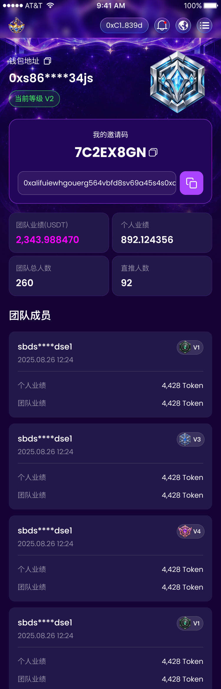

# 我的团队实现清单（已确认）

## 范围与事实来源

- 目标：还原Figma `NVwAAv12WZx1LiCTqPMNWD` / `30204:3490` 的我的团队静态页面，完成钱包、邀请码和邀请内容的复制反馈，展示四项统计与四张成员卡。
- 允许修改：新增 `src/pages/main/team/`、`src/assets/team/`、页面文档；增量注册 `/team` 路由，并将既有侧栏“社区”入口接入该路由，保留其现有名称与结构；在 `src/styles/color.scss` 增加确实缺失的颜色变量，更新相关路由文档和行为测试。
- 明确不做：API/ABI、邀请关系绑定、真实团队计算、真实分页、钱包或共享Header重写、新依赖、其他页面视觉、远程Git和Logo门禁修改。
- 依据：指定节点的Figma MCP读取、REST原始图层属性、完整画板截图、开发者Downloads资源、PROJECT_TERMS.md及项目布局/路由/剪贴板文档。精确属性保存在 `docs/design-reference/yuanbao-team-measurements.json`；未采用截图目测替代可读取参数。
- 工作区存在首页、侧栏、卡包、抢拍和路由等未提交改动；只在上述必要位置增量修改，保护已有工作。

## 画板与共享外壳

- 画板750×2330。顶部设备状态栏28px不实现、不预留，H5目标高度2302px。
- 保持既有100px共享Header及其品牌、钱包、通知、语言和菜单交互。正文坐标以原稿y减28作为验收目标，SCSS仍输入750px设计源尺寸。
- 原稿顶部没有“我的团队”标题栏；不额外添加标题或SecondaryHeader。

## 资源核对与语义路径

| 原文件或图层 | 目标路径 | 源/显示尺寸 | 状态 |
| --- | --- | --- | --- |
| Downloads/image 4928.png；30204:3614 | src/assets/team/level-v2.png | 236×236 | 已核对银蓝色等级艺术图 |
| Downloads/Frame 2147236601.png；30204:3691/3787 | src/assets/team/member-level-v1.png | 90×48 | 已核对绿色V1完整徽章 |
| Downloads/Group 1312317164.png；30204:3644 | src/assets/team/invitation-copy.png | 80×80 | 已核对紫色复制按钮完整图 |
| 30204:3751 | src/assets/team/member-level-v3.png | 94×48 | 缺少蓝色V3完整徽章 |
| 30204:3769 | src/assets/team/member-level-v4.png | 94×48 | 缺少紫色V4完整徽章 |
| 30204:3628 | src/assets/team/wallet-copy.svg | 30×30 | 缺少白色复制图标；既有wallet-copy.png为紫色，不能替代 |
| 30204:3640 | src/assets/team/code-copy.svg | 29×28 | 缺少白色复制图标，尺寸与钱包复制图标不同 |
| 30204:3491/3492 | src/assets/team/hero-background-back.png / hero-background-front.png | 749×888 / 750×888 | 原稿叠加两层图片，需核对已有卡包背景是否为同一完整导出；不同则补导精确两层 |

背景两层的imageRef均为461a0a4a62e81c49a30424de16ac13d2192a1665，但y裁切参数分别为0.538032054901123/0.211100772023201与0.5374268889427185/0.22116726636886597，并带-0.07999999821186066曝光与透明度0.2到1的纵向深紫叠层；相同imageRef不意味着完整导出可以互换。已导出的参考画板仅用于验收，不能作为实现资源。

补导建议是以上明确节点，按1倍导出完整徽章和图标，不重画、不换色。等待开发者确认清单及补导方式后执行。

## 正常流结构与语义

1. 钱包信息：两列Grid，左侧钱包标签、地址、等级胶囊，右侧236px等级艺术图。钱包复制用button，图标img且alt空；艺术图提供等级说明。
2. 邀请面板：section内列向Flex；邀请码与复制按钮同一行；底部只读邀请内容输入框与复制button用Grid，间距12px。输入框readonly，不把纯展示文字误做可编辑字段。
3. 统计：dl与dt/dd，2×2 Grid，列间距10px、行间距10px，维持四项顺序。
4. 成员：section标题与ul/li，卡内身份/时间/徽章以Flex排列，分隔线后dl显示两项业绩；四卡间距20px。

复用 `.flex`、`.flex-column`、`.items-center`、`.justify-between`、`.flex-center`、`.tc`；复用 `gradient-card`、`hide-scrollbar` 等mixin。只在必要的私有背景或图层尺寸处补SCSS。唯一定位例外是星空 `background-art`，覆盖共享Header后方，不承担内容布局，添加layout-exception说明。其余信息、卡片、徽章、复制按钮全部正常流。

## 精确设计参数

下列坐标保留Figma原始值，仅用于验收；内容实现按正常流推导padding/gap。完整浮点颜色和所有图层见measurements JSON。

| 内容 | 源尺寸/坐标 | 字体、字号/字重/行高 | 样式 |
| --- | --- | --- | --- |
| 钱包标签 | x30/y188，104×36；图标间距12 | PingFang SC 26/400/36.39999771118164 | 白色，字距0 |
| 钱包地址 | x30/y234，287×60 | Poppins 40/600/60 | 白色，字距0 |
| V2等级胶囊 | x30/y306，173×56 | Poppins 24/400/36 | 圆角999、padding8/20、1px内描边#45FF67，背景同色10% |
| 等级艺术图 | x484/y158，236×236 | — | 保留原图透明区与宽高 |
| 邀请面板 | x30/y402，690×287 | — | 背景#22065A、圆角30、2px内描边；180°渐变#AB44FF 50%→#FB00FF 50%→#AB44FF 50%，色标0/50/100% |
| 我的邀请码 | 面板内x285/y40，120×28 | Roboto 24/400/28.125 | 居中、字距0 |
| 邀请码 | 面板内x223/y78，244×69 | Poppins 46/700/69 | 居中、字距0，复制图标x475/y99，29×28 |
| 邀请内容行 | 面板内x30/y177，630×80 | Poppins 24/400/36 | 输入框538×80、圆角20、2px内描边#F6EEFF 20%、白色6%背景；复制按钮80×80；间距12 |
| 统计区 | x30/y719，690宽；四卡340×136 | 标签PingFang SC 24/400/33.599998474121094；数值Poppins 32/600/48 | 背景#24184A、1px内描边#8644FF 20%、圆角24；左列padding24，右列文字起点30，标签和值gap10 |
| 团队成员标题 | x30/y1041，144×50 | PingFang SC 36/600/50.39999771118164 | 白色，字距0 |
| 成员卡 | 首张x30/y1121，690×291；间距20 | — | 背景#24184A、圆角20；左右padding30 |
| 成员名称 | 卡内x30/y30，186×42 | Poppins 28/500/42 | 白色，字距0 |
| 时间 | 卡内x30/y78，189×36 | Poppins 24/400/36 | 白色50%，字距0 |
| 徽章 | 卡内x570/y30，V1为90×48，V3/V4为94×48 | 徽章内文PingFang SC 20/600/28 | 用完整切图，原图层背景模糊radius8，不额外重复绘制 |
| 卡内分隔线 | x30/y134，630×1 | — | 白色20% |
| 卡内业绩 | x30/y165，630宽；两行36高、gap24 | Poppins 24/400/36 | 标签白色50%，数值白色，字距0 |

统计值团队业绩色为原始rgb(98.333340883255% 0% 100%)，可复用既有app-card-pack-title-accent；其它统计数值为白色。通用背景、白色、50%文字、20%边框、邀请面板渐变优先复用既有token；缺少的#24184A面板、#45FF67等级状态、6%输入背景与#F6EEFF 20%边框集中到color.scss，页面不散落裸色值。保持字体和颜色的精确源值，不对浮点值手动取整。

## 字体、数据与本地交互

- 原稿字体为PingFang SC、Poppins、Roboto。项目没有可确认的Poppins字体资源；拟沿用当前抢拍/卡包采用的微软雅黑fallback，保留原稿字号、字重、行高、字距。该字体替换需随清单批准，属于字形差异，不能称为严格1:1。
- 示例数据仅取设计：邀请码7C2EX8GN、统计2,343.988470/892.124356/260/92、四名成员sbds****dse1、时间2025.08.26 12:24、两项业绩各4,428 Token、等级V1/V3/V4/V1。不编造后台字段、资产、升等级门槛或邀请域名。
- 正式路由钱包地址读取既有useDappStore，展示脱敏值；无钱包时展示--，禁用钱包复制，不复制脱敏字符串。独立视觉预览可使用原稿地址示例，不改变钱包store。
- 邀请码及邀请内容保留设计示例供静态本地交互，复制使用copyTextToClipboard及Toast，成功/失败分别提示。原稿邀请内容是非标准URL的示例字符串，不能从它推导真实邀请链接或绑定规则；不生成当前域名链接。模块文档明确设计fixture用途，后续API接入时整体替换。
- 原静态阶段无真实数据加载，不加空下拉刷新；现经开发者追加授权接入有限本地预览分页，见下方补充。
- PROJECT_TERMS暂无已确认替换规则，保留USDT、Token及数值原文。

## 验收与待确认项

- 750×2302与375×1151截图对照，核对几何、两层背景、每个资产的实际尺寸与加载、长文本裁切、无横向溢出；只修正本页面范围。
- 检查路由和社区入口、侧栏关闭后恢复滚动、公共Header原有交互；复制验证原始字符串与反馈，无钱包复制禁用。
- `git diff --check`、`pnpm exec tsc -b`、`pnpm lint`、`pnpm test`、`pnpm build`；Logo未就绪门禁保持，若阻断构建如实报告。
- 待确认：本清单、沿用微软雅黑字体、从上述明确节点补导缺少的V3/V4徽章与白色复制图标（以及无法精确复用的背景），侧栏社区入口对应/team。
- 当前已完成设计读取、原始量测、下载资源核对和清单；尚未实现页面源码。

## 开发者确认与实现决定

- 开发者确认开始，等级默认全部使用V1图标；当前等级文案改为V1，四张成员卡全部用现有90×48 V1徽章，不下载V3/V4。顶部艺术图沿用已提供的image 4928资源，语义文件名为level-v1.png，作为本页默认等级装饰，不以文件名建立真实等级映射。
- 已确认沿用微软雅黑fallback与社区入口/team；复制SVG及两层背景按清单精确节点补导。三个手动下载图均按原尺寸复制至team资源目录。
- 原稿最后一张成员卡底部超出画板15px：正常流保留四张完整卡片，允许用户滚动到底部，不裁掉有效内容。与原稿截断底部的差异记录为响应式行为处理。
- 页面源码已按本清单实现，待静态检查和浏览器验收。

## 验收记录

- 750px：等级艺术图x484/y129.992/236×236；邀请码面板x30/y373.984/690×287；输入框x59.992/y550.969/538.016×80；统计区x30/y690.984/690×281.977；成员标题y1012.953，首张成员卡x30/y1092.953/690×291。与原稿去掉28px设备栏后的源坐标误差小于0.05px。
- 375px：页面文档宽375，无横向溢出；艺术图118×118，复制大按钮40×40，四张V1徽章全部45×24；8个页面img均加载成功，7个本地资源文件非空。两张背景以375×444及374.5×444叠加，保留原图层裁切；项目1px/2px保留为物理像素的既有规则会使内框坐标与纯0.5缩放产生约1px差异，未绕过该公共规则。
- 浏览器点击邀请码和邀请内容复制后分别显示成功反馈，并在独立临时输入框通过真实键盘粘贴确认内容为7C2EX8GN及完整设计字符串。临时验证页和浏览器标签已清理。未连接钱包时显示--，钱包复制禁用。
- 从团队页经侧栏返回首页，再点击社区进入/h5/team；侧栏关闭、滚动锁恢复、路由滚动归零。控制台warn/error为空。
- 新增两项运行时回归，执行真实TeamPage事件处理：无钱包不复制，连接钱包展示脱敏值但复制原始完整地址；只读邀请输入复制完整内容，剪贴板失败单独显示error反馈。共享剪贴板组件既有降级测试仍通过。
- `pnpm build`前置lint及242项测试全部通过，随后被既有Logo未就绪门禁阻断，不能视为生产构建成功。`pnpm exec tsc -b`及`git diff --check`通过。
- 批准差异为微软雅黑fallback、默认全部V1及保留末卡超出原画板的15px完整内容；真实钱包连接/团队API未做生产验收，当前统计与邀请内容仍为设计fixture。
- 保存完整手机截图 `docs/design-reference/yuanbao-team-375.png`；`yuanbao-team-750.png`为原生设计宽度截图，受浏览器1724px捕获高度限制仅记录上部，其余成员卡通过完整手机截图和DOM几何核对。最终钱包地址框保留原稿287px源宽度；末次CSS微调后lint和diff检查再次通过。

## 刷新、分页与空状态补充（2026-09-28）

开发者要求资产与团队接入公共下拉刷新、上拉加载、暂无数据。四名设计成员按每页两名有限加载，刷新等待首页成员、统计及邀请示例重新加载；成员等级继续全部V1。复用PagePullRefresh/DropletLoading/Empty，不改公共组件契约；空列表隐藏“没有更多了”，失败提供重新加载，追加失败保留当前列表和页码以便重试。无API请求或业务协议假设，不改原设计卡片排版。

验证覆盖团队实际页面注册和Empty分支、刷新Promise等待、重复追加拦截及错误隔离。375px浏览器确认2名追加为4名、末页“没有更多了”、无横向溢出和控制台错误；桌面浏览器未实测手机触摸下拉，公共触摸手势链路通过运行回归。pnpm verify通过250项测试，tsc及diff检查通过。pnpm build在验证通过后仍被既有Logo未就绪门禁阻止。
